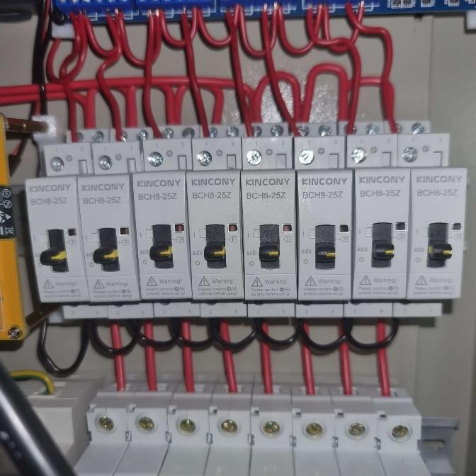
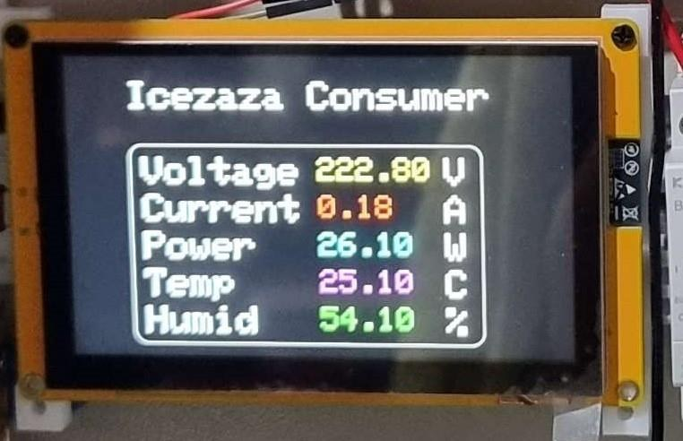
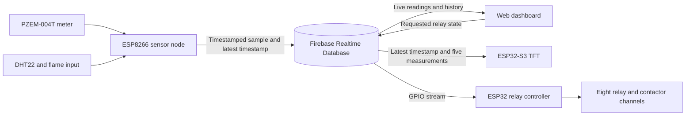
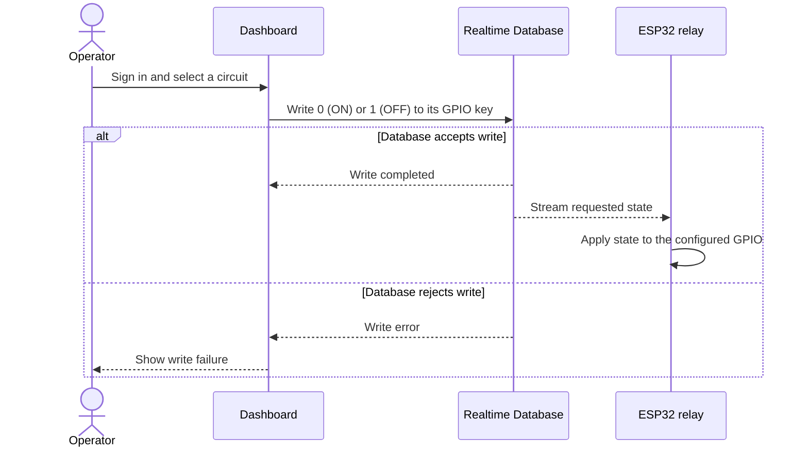

# Smart Consumer Unit

An eight-circuit electrical distribution cabinet built for an undergraduate computer engineering project by **Terasit Juntarasombut**. Three microcontrollers share one Firebase Realtime Database. An operator can request a circuit change from the browser, inspect historical readings, or walk up to the cabinet and read the TFT.

**[Try the interactive cabinet showcase →](https://icezaza2543.github.io/Smart-Consumer-Unit/)**

Toggle eight simulated circuits, see how the hardware fits together, and browse seven measurements from 35,980 sensor records captured on 19–24 March 2023 (Bangkok time). Select a day and inspect five-minute means. The demo runs entirely from static files and opens without signing in.

| Eight contactors installed in the cabinet | Live measurements on the cabinet door |
|:---:|:---:|
|  |  |

*Prototype photographs from thesis figures 4.9 and 4.26. The repository contains the firmware and dashboard adapted from the project defense archive.*

[Hardware and data flow](#hardware-and-data-flow) · [Control workflow](#control-workflow) · [Run the dashboard](#run-the-dashboard) · [Build the firmware](#build-the-firmware)

## Hardware and data flow



| Component | Responsibility | Entry point |
|---|---|---|
| ESP8266 | Read sensors, obtain Unix time by NTP and publish at startup and every 30 minutes | [Sensor sketch](firmware/ESP8266VCTFPZEMPFire/ESP8266VCTFPZEMPFire.ino) |
| ESP32 | Initialize eight active-low outputs to OFF and apply streamed relay states | [Relay sketch](firmware/ESP32_Firebase_SmartConsumer_Relay/ESP32_Firebase_SmartConsumer_Relay.ino) |
| ESP32-S3 | Poll the latest timestamp about every 15 seconds and display V, A, W, °C and %RH on an 800 × 480 RGB panel | [Display sketch](firmware/ESP32S3LVGL/ESP32S3LVGL.ino) |
| Browser | Authenticate, show the latest sample, request relay states and plot history | [Control page](web/public/index.html) · [History page](web/public/PageTwo.html) |

## Control workflow



The dashboard reports the requested state stored in Firebase. A successful write confirms database acceptance. The prototype has no per-circuit contact-position feedback, and the meter measures the shared load.

## Database contract

All paths below are relative to **board1**. Firmware, website and rules must point to the same project.

| Path | Writer | Stored value |
|---|---|---|
| `Sensor/<unix-seconds>` | ESP8266 | A sample with string fields `timestamp`, `voltage`, `current`, `power`, `temperature`, `humidity`, `Freq`, `PowerFactor` and `FlameStatus`. The dashboard also reads the historical key `Power Factor`. |
| `Display/Time` | ESP8266 | Integer timestamp identifying the latest published sample. Both paths are published in one update. |
| `outputs/digital/<gpio>` | Control page | Integer 0 or 1. Circuits 1–8 map to GPIO 2, 4, 5, 21, 14, 15, 16 and 17 in that order. |
| `charts/range` | History page | Number of samples to display, from 1 to 1000. The default is 40. |

A meter reading of **power** is in watts. The PZEM sketch also prints cumulative energy over serial. The stored sample schema above contains instantaneous power.

## Run the dashboard

1. Create your own Firebase project with a Realtime Database and enable **Email/Password** authentication. Create the operator account and copy its UID. Registering an account on the website alone does not grant database access.
2. In [database.rules.json](web/database.rules.json), replace `YOUR_OPERATOR_UID` with that UID in both rules. Publish the rules to your project. The prototype uses one operator identity for the dashboard and boards.
3. In a **new, empty** database, create the `board1` node with the contents of [board1.example.json](web/board1.example.json). All eight requested outputs start OFF. On an existing installation, preserve the stored states.
4. From the repository root, run the following commands in PowerShell. Fill the copied file with the web app configuration from your Firebase project before signing in.

```powershell
Copy-Item web/public/scripts/firebase-config.example.js web/public/scripts/firebase-config.js
python -m http.server 8000 --bind 127.0.0.1 --directory web/public
```

Open **http://127.0.0.1:8000** in your browser. The static page uses the Firebase SDK and Highcharts from CDNs and connects to the database specified in your local configuration. Test with a separate project and disconnected loads. Once readings arrive, the home page shows the latest sample and the history page plots the selected number of samples.

## Build the firmware

Install the **esp32** and **esp8266** board packages in Arduino IDE or Arduino CLI. Open the sketch for the board you are building. In its folder, copy `secrets.h.example` to `secrets.h` and enter the Wi-Fi settings, Firebase Web API key, database URL and the operator account credentials. The local header and web configuration file are Git-ignored.

| Board | Library dependencies beyond the board package |
|---|---|
| All three | Firebase Arduino Client Library for ESP8266 and ESP32 (`Firebase_ESP_Client.h`), Adafruit Unified Sensor |
| ESP8266 | DHT sensor library, NTPClient, PZEM004Tv30, Adafruit ADS1X15 and its BusIO dependency |
| ESP32-S3 | GFX Library for Arduino. The RGB pin map and timing in the sketch are specific to the prototype panel. |

The three sketches compile with ESP8266 core 3.1.2, ESP32 core 3.2.0 and Firebase ESP Client 4.4.17. The display build uses GFX Library for Arduino 1.6.0. The sensor build uses PZEM004Tv30 1.2.1, NTPClient 3.2.1 and DHT sensor library 1.4.6.

Select the NodeMCU ESP8266, ESP32, or ESP32-S3 board profile as appropriate. Enable the PSRAM mode fitted to the S3 display module. Verify each sketch before uploading. The flame input in this version treats HIGH as detection, following the archived sensor test. Verify polarity on the fitted module before relying on its indication.

## Verify a fresh setup

- Sign in to the new project. With the supplied seed, the eight commands read OFF. An uninitialized channel reads **Unavailable**.
- Publish a sensor sample and check that its timestamp and values agree on the home page and TFT. On the history page, change the sample range and confirm that each new sample appears once.
- Use a disconnected relay bench to compare the requested states with the GPIO output. If the dashboard shows **Write failed**, check the signed-in UID against the deployed rules.

The accompanying research used monthly meter readings for its energy comparison. The dashboard and its sensor history here document the prototype’s operation. They do not independently establish energy savings.
